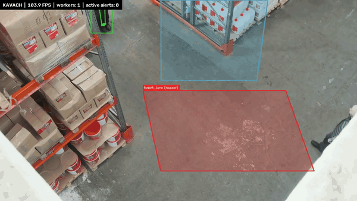

# Kavach: vision-based worker safety monitoring



*First: an overhead warehouse camera. The blue walkway never alerts; workers whose feet enter the red forklift lane are flagged and logged. Then: a person lying still on the floor goes NORMAL → DOWN → MAN_DOWN (red) after 4 s without movement. Footage: Pexels, see `samples/SOURCES.md`.*

Kavach watches an industrial camera feed and raises safety events for each worker:

- **Danger-zone intrusion**: a worker's *feet* (not box centre) inside a floor polygon for N frames.
- **Fall and man-down**: from body-pose keypoints (torso angle, posture, stillness) through a small state machine.
- **PPE compliance**: helmet and hi-vis vest, from a YOLO11s detector fine-tuned on [SH17](https://arxiv.org/abs/2407.04590). *(Training in progress; the PPE checks switch on automatically when the weights are in `weights/`.)*

Each event is written to `events.jsonl` with a snapshot crop. The annotated video shows IDs, skeletons, zone overlays, a HUD and an alert ticker.

## Pipeline

```
frame ─► YOLO11s-pose ─► ByteTrack (persistent IDs) ─┐  person boxes + 17 keypoints
frame ─► YOLO11s-PPE (SH17) ─► helmet / vest boxes ───┤
                                                     ▼
            association: PPE box ↔ keypoint-anchored head / torso region (IoA, greedy 1-to-1)
                                                     ▼
   per-track state:  zone dwell  │  man-down state machine  │  PPE debounce window
                                                     ▼
                  events.jsonl + snapshots ─► OpenCV renderer ─► out.mp4
```

Detection, pose and tracking come from Ultralytics. Everything after that (geometry, association, zones, state machines, events, rendering) is hand-written NumPy/OpenCV in `kavach/`.

## Quick start

```bash
uv sync                                   # Python 3.11, installs ultralytics / opencv / numpy
uv run python -m kavach.run --source samples/clip2.mp4 --site configs/sites/warehouse_overhead.yaml
#   -> outputs/clip2/out.mp4, events.jsonl, snapshots/, summary.json (FPS + per-stage ms)
# The YOLO11s-pose weights download automatically on first run (into weights/).
uv run python -m kavach.run --source 0 --show   # webcam, live window
uv run pytest -q
```

Zones are polygons in **normalised** (0–1) image coordinates in a site YAML, so one file works at any resolution:

```yaml
zones:
  - name: press_area
    type: hazard            # restricted | hazard | walkway (walkway never alerts)
    points: [[0.10, 0.60], [0.45, 0.60], [0.50, 0.95], [0.05, 0.95]]
    min_dwell_frames: 5
```

## Design decisions

| Decision | Why |
|---|---|
| **Foot point** for zones (ankle keypoints, else box bottom-centre) | Zones are painted on the floor. Using the box centre would flag a worker standing *next to* a zone, because their waist is drawn over it. |
| **Dwell debounce** (`min_dwell_frames`) | One jittery detection on a zone boundary would otherwise spam alerts. |
| **Tri-state PPE** (OK / MISSING / UNKNOWN) | Back of head, occlusion or a tiny far-away worker means "can't tell", which never becomes a violation. False alarms are what make operators stop trusting safety systems. |
| **IoA, not IoU**, for PPE ↔ person | A helmet is much smaller than a head region; IoU would be low even for a perfect match. Greedy one-to-one matching stops one helmet from counting for two people. |
| **Sliding-window PPE debounce** (≥ 70 % MISSING among ≥ 8 known frames) | A single missed detection shouldn't raise a violation. |
| **Man-down = lying + still**, FALL only after being seen upright | Someone already lying when first seen (e.g. working under a vehicle) is not a fall. A worker moving on the floor is DOWN, not MAN_DOWN. Stillness is keypoint *path length* per second, normalised by body size, so waving for help counts as movement. |
| **Video time, not wall clock**, in all state machines | The same video gives the same events on any machine, which makes the logic testable. |
| **Live sources: reader thread + 2-frame queue that drops old frames** | A slow model then shows the current scene instead of a growing backlog. |
| **Per-event cooldown** | Logs one event per (worker, type, zone) per 10 s instead of one per frame. |

## Results

**Runtime** (`results/runtime_mac.json`): Apple M5 Pro laptop, PyTorch MPS, YOLO11s-pose at imgsz 640, PPE off. End to end means decode → pose + ByteTrack → logic → render → encode, with model warm-up included.

| Clip (Pexels, 720p) | Frames | End-to-end FPS | Pose + track ms/frame | Events logged |
|---|---:|---:|---:|---|
| Warehouse aisle, 2 workers | 421 | 48.3 | 16.8 | none |
| Overhead warehouse, 3 workers + zones | 609 | 59.5 | 13.1 | 3 × ZONE_INTRUSION |
| Garment factory, 6+ workers | 260 | 44.5 | 18.3 | none |
| Person lying on the floor | 470 | 56.2 | 14.6 | FALL, MAN_DOWN |

Logic and rendering together take under 1 ms per frame; nearly all the time is the pose network.

These are qualitative demo clips, **not an accuracy benchmark**. The "person lying on the floor" clip shows someone lowering themselves slowly. The rule still raised FALL because they were upright within 2 s of lying down, so the rule can't yet tell a controlled lie-down from a fall. That is exactly what the temporal model in the roadmap is for, with labelled data (Le2i) and event-level precision/recall.

**PPE detector:** training on SH17 is in progress (Kaggle T4, `notebooks/01_train_ppe_yolo.ipynb`). The metrics will be added from `results/ppe/ppe_val_metrics.json` when the run finishes.

## Project layout

```
kavach/       geometry, zones, mandown, ppe, events, render, video, config, run (CLI)
configs/      default.yaml (thresholds), sites/*.yaml (zones)
notebooks/    01_train_ppe_yolo.ipynb: SH17 fine-tuning on a Kaggle T4
tests/        pytest: geometry, zones, man-down state machine, PPE association + debounce
tools/        make_gif.sh
```

## Limitations

- The man-down rule uses torso angle, so it can't see a fall straight towards or away from the camera (the torso stays near-vertical in the image). The next step is a temporal model on keypoint sequences (below).
- A single fixed camera, no re-identification across cameras; IDs can switch after long occlusions.
- Thresholds were tuned by eye on a few clips, not fitted on a labelled industrial dataset.

## Roadmap

- [ ] PPE detector: YOLO11s fine-tuned on SH17, per-class AP vs the paper's baseline
- [ ] Temporal fall model (1D-CNN vs Random Forest vs this rule baseline) on Le2i keypoint sequences, with a cross-scene split and detection-delay metrics
- [ ] CNN vs ViT crop verifier to confirm PPE violations and cut false alarms
- [ ] Low-light CLAHE, homography for real-world distances, occupancy heatmap, face blur, ONNX export + FPS benchmark

## Credits and licence

Built on [Ultralytics YOLO11](https://github.com/ultralytics/ultralytics) (AGPL-3.0), so this repo is **AGPL-3.0**. PPE data: SH17 (CC BY-NC-SA 4.0); no dataset images are included in the repo. Demo footage: see `samples/SOURCES.md`.
